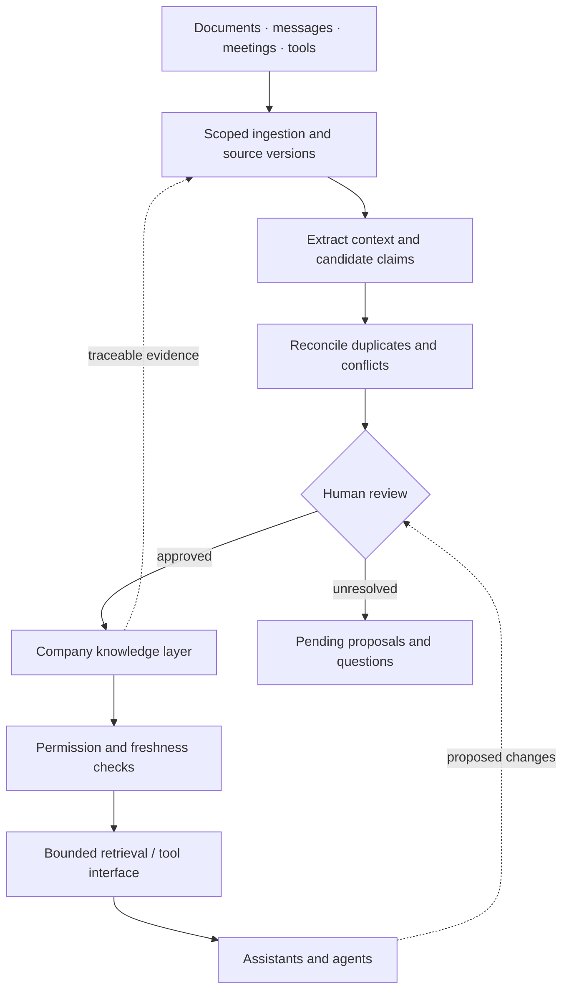

# Briefcase

Briefcase explores company knowledge infrastructure: turning fragmented information into structured, traceable context that AI assistants and agents can use.

This is a public technical showcase with an original, credential-free demonstration. It explains the Enterprise Brain concept; it is not a release of the production platform. [Briefcase website](https://www.briefcasegroup.com/).

## The problem

Company information lives across documents, email, chats, meetings, calendars, internal tools and people. A campaign proposal, a meeting discussion and an approved decision can describe different versions of the same plan.

Putting those documents into an LLM does not tell it which statement is authoritative, who can read it, whether it is current, or what changed. Retrieving a relevant paragraph is only part of answering a company question.

## The idea

An Enterprise Brain preserves source evidence, organizes knowledge by responsibility and domain, and separates facts, proposals, decisions and open questions. Reviewed knowledge becomes reusable context. Assistants retrieve bounded evidence; tools can expose permitted operations when appropriate.



This is a conceptual architecture, not a deployment diagram. [Architecture and boundaries](docs/architecture.md).

## Try the synthetic example

Northstar Hotels is an invented company. Its draft proposes discount advertising; a meeting chooses direct-booking content instead; an approved decision records that choice. Every person, document, date and business detail in the fixture is fictional.

Python 3.10+; standard library only. From this repository:

```sh
python3 demo/brain.py "What was decided about the hotel's Q4 marketing strategy?"
python3 -m unittest discover -s demo -p 'test_*.py' -v
```

The CLI returns structured JSON containing:

```json
{
  "status": "answered",
  "as_of": "2026-10-20",
  "answer": {
    "decision": "Prioritize direct-booking content for the Q4 hotel campaign; do not launch the proposed discount ads.",
    "owner": "Morgan Vale (fictional)",
    "scope": "Northstar Hotels / Q4 marketing"
  },
  "decision_id": "NS-DEC-02"
}
```

The full response includes three source paths, line ranges and SHA-256 fingerprints, plus a warning that the draft is not an approved decision. Change a cited source without updating its reviewed fingerprint and the demo refuses to answer. Ask about an unrelated subject and it abstains. [Fixture walkthrough](example/README.md).

## What this repository implements

| Area | Here |
| --- | --- |
| Knowledge model | Synthetic JSON records, evidence links, approval and validity fields |
| Retrieval | Small deterministic topic matcher with domain and audience filters |
| Answer construction | Template from the eligible approved decision, with evidence integrity checks |
| Governance | Refusal on conflicting decisions, stale evidence or missing review |
| Connectors, semantic retrieval, MCP | Discussed as interface design; no live integrations or MCP server |
| External actions | None; the demonstration only reads bundled files |

## Technical challenges

- **Freshness and provenance:** source detection, content extraction and reviewed knowledge need distinct checkpoints. A successful scan does not establish a current answer.
- **Conflicting information:** recency alone cannot settle authority. Superseded decisions and unresolved proposals need explicit status.
- **Permissions:** filtering must happen before evidence enters model context, including citations and caches. The demo's audience flag illustrates filtering, not authentication.
- **Entity resolution:** aliases can connect references, but merging two similarly named projects can corrupt context. Ambiguous matches need review.
- **Retrieval and context windows:** select a small, coherent evidence set rather than filling a prompt with every document. Evaluate abstention and provenance alongside relevance.
- **Structured and unstructured knowledge:** typed records make review and filtering explicit; source excerpts preserve nuance and allow verification.
- **Agent access and updates:** a tool protocol can expose read operations and change proposals. Authorization and approval of side effects still belong to the application.

[Knowledge model](docs/knowledge-model.md) · [Ingestion](docs/ingestion-pipeline.md) · [Agent access](docs/agent-access.md)

## My role

I am a Briefcase co-founder and builder working on product architecture, knowledge-system design and AI/agent workflows. My hands-on work includes local ingestion tooling, structured knowledge experiments, deterministic indexing and review flows. I use prototypes to test how source evidence becomes useful company context, while keeping proposals distinct from accepted decisions.

This showcase is a deliberately small implementation of those ideas. It does not establish production scale, retrieval quality across real companies, or autonomous operation. See [Briefcase](https://www.briefcasegroup.com/) for the public company introduction.

## Scope and reuse

All examples are synthetic. No company knowledge base, connector output, credentials or private code is distributed. The code and documentation in this repository are available under the [MIT license](LICENSE); the license does not grant rights to Briefcase branding or unrelated materials on its website.
