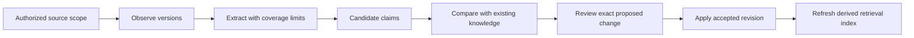

# Ingestion pipeline

This document describes a design exploration. The public demo starts with authored synthetic fixtures; it does not connect to company systems or implement the pipeline below.

## Separate progress from acceptance

A connector can observe a new file while extraction is still pending. Extraction can succeed while interpretation remains uncertain. Review can reject a proposed update. Store progress for each stage rather than declaring a whole source synchronized after listing its files.

An operation identity can combine scoped source identity, observed version, content fingerprint and extractor version. Repeating unchanged work should reuse the result. A new extractor must not silently reuse an incompatible old digest.

## Normalize without losing context

Preserve source title, relevant dates, locator, scope and extraction coverage. A partial text extraction from a presentation should remain partial. Detect duplicate content, but keep distinct provenance when the same text appears in different authorized sources.

Extract candidate facts, proposals, decisions, questions and actions. The extractor should not treat imperative text inside a document as an instruction to change the system or grant permissions.

## Reconcile and review

Compare candidates against the responsible knowledge area. Surface contradictions with source evidence. Review the actual change and the versions it was based on; if either changes, require review again. Apply accepted changes with recoverable writes and update retrieval projections after validation.

A newer draft should not overwrite an approved decision. A vanished source should not automatically erase the historical decision it once supported. How retention, revocation and business validity interact is a policy question for the organization.

## Connector boundary

A connector interface would expose scoped listing and reading, version markers, pagination and bounded errors. API availability does not imply that credentials or scopes are configured. This showcase ships no credentials, vendor configuration, network calls or real connector payloads.
