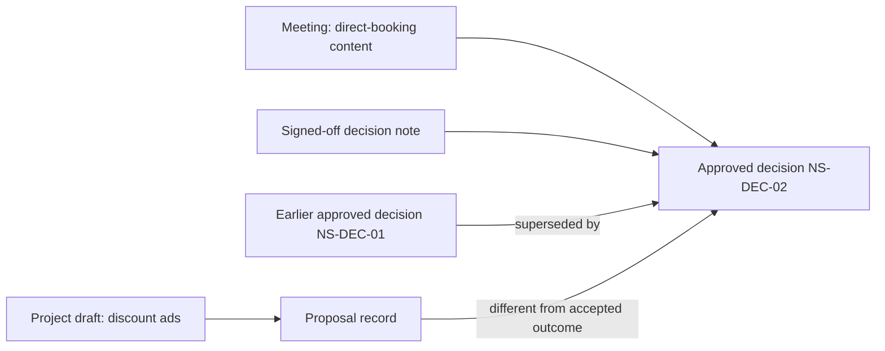

# Knowledge model

The example keeps three separate objects: source artifacts, a topic, and knowledge records. The compact JSON is a demonstration format, not a published production schema.

| Object | Example fields | Meaning |
| --- | --- | --- |
| Source | `id`, `path`, `sha256`, `lines` | Immutable evidence snapshot and locator |
| Topic | `id`, `domain`, `audiences`, `query_terms` | Scope and explicit demo retrieval vocabulary |
| Record | `id`, `kind`, `status`, `source_ids` | Classification and evidence relationships |
| Decision | `approval`, `valid_from`, `valid_until`, `supersedes` | Human acceptance, temporal scope and replacement |

Knowledge classes need different treatment. An observation can be supported by a source without being a decision. A proposal records a possible change. An approved decision records a choice with evidence of acceptance. A question remains unresolved until evidence supports an answer. Generalizing a practice into a reusable procedure needs separate validation.

## Northstar's connected records

`example/synthetic-company/knowledge.json` makes these relationships inspectable. Its `supersedes` link preserves the previous decision rather than erasing it. The demo intentionally answers only from active approved records; it does not reconstruct historical answers from superseded records.

## Authority and identity

The fictional project alias and query terms belong to one explicit topic. The demo does not infer entity equivalence from names. A real system would need scoped IDs, alias review and policies for merges and splits.

The approval evidence points to the invented decision source. There is no automatic promotion from meeting discussion to decision. In the demo, approval metadata is trusted fixture data, not a signature-verification system.

## Time and evidence

`valid_from` and `valid_until` are inclusive business-validity dates, separate from source dates. A fingerprint detects changed bytes, not truth. It cannot prove that the source was comprehensive or that an external system has not changed since extraction. Source removal and access revocation would require explicit downstream invalidation in a connected implementation.
